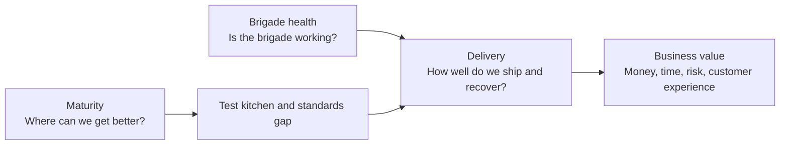

# Measuring Value

*How the brigade shows what it is worth, to itself and to the business.*

The kitchen measures three layers. Each answers one question for one audience, and each feeds the next. A fourth track, maturity, shows where to improve and feeds the test kitchen.

## Layer 1: Brigade health

For the brigade itself. Every signal comes from artifacts the model already produces.

| Signal | How to measure | Look for |
| --- | --- | --- |
| Minimum output | Weeks met ÷ weeks, per counter | Every week met |
| Happiness | Thumbs up ÷ cast votes, per counter | Stable or rising |
| Family-meal share | Share of output done for the brigade itself | Neither zero nor dominant |
| Test kitchen | Experiments finished per month, and the share proven | A steady flow |
| Standards gap | Open gap items per counter | Shrinking |
| Gateway response | Time to acknowledge a request, against the charter's promise | Within the promise |

## Layer 2: Delivery (DORA)

For the brigade, its regulars and the product teams whose dishes pass through. DORA tracks five software delivery metrics in two groups:

| Group | Metric | What it measures |
| --- | --- | --- |
| Throughput | Deployment frequency | How often changes reach production |
| Throughput | Change lead time | Time from commit to running in production |
| Throughput | Failed deployment recovery time | Time to recover from a deployment that failed in production |
| Instability | Change failure rate | Share of deployments that need immediate remediation |
| Instability | Deployment rework rate | Share of deployments that were unplanned, made to fix a production issue |

Add **reliability**: the share of time each service meets its service level objectives.

- **Ownership:** the CI/CD counter runs the collection. Each counter owns its own instability metrics. Recovery belongs to everyone.
- **Compare a counter only with its own past.** DORA itself no longer ranks teams into fixed tiers, and Open Kitchen never ranks counters against each other.
- **Read throughput and instability together.** More deployments with rising rework is not progress.

## Layer 3: Business value

For the manager and the organization's peers. Every result is translated into one of four currencies:

| Currency | Question | Example measures | Who cares most |
| --- | --- | --- | --- |
| Money | What does it cost, and what did we save? | Infrastructure cost per month, cost per service or environment, license spend | Finance, the manager |
| Time | How fast does work move? | Change lead time, hours of toil removed, time to onboard a new service | Product, planning |
| Risk | How likely is failure, and how bad? | Incidents by severity, SLO breaches, open single points of failure, critical versions behind, restore tests passed | Security, leadership |
| Customer experience | What do users feel? | Availability and latency of user-facing services, user-impacting incident minutes | Product, support |

**The translation rule:** a notable change isn't finished until it names a currency and a number. "Moved old metrics to object storage" is unfinished; "moved old metrics to object storage: €400/month saved" is done.

- **Measure, don't invent.** Show risk as exposure before and after, not as imagined savings from incidents that didn't happen.
- **Mark estimates as estimates,** and replace them with measured numbers when they exist.

## Who gets what, and when

| Rhythm | Report | Audience | Contents |
| --- | --- | --- | --- |
| Weekly | [Counter changelog](templates/weekly-changelog.md) | The brigade, regulars, product teams | Delivered work, family meal, test kitchen, decisions, incidents |
| Weekly | [Manager summary](templates/weekly-summary.md) | The manager | One page from all changelogs |
| Monthly | [Value report](templates/value-report.md) | The manager and peers: product teams, planning, finance, security | Delivery trend, the four currencies, wins, risks, asks |
| Quarterly | Maturity review | The brigade and the manager | Assessment, targets for the next quarter |

## Maturity

Open Kitchen is a management model, not a maturity model. It pairs with an existing maturity framework instead of inventing one.

Every quarter, each counter assesses the capabilities it serves, sets targets for the next quarter, and turns the gaps into standards-gap items for the test kitchen. Not every capability needs the top level: decide per capability how much is enough.

Two frameworks fit well:

- **[adidas DevOps Maturity Framework](https://github.com/adidas/adidas-devops-maturity-framework).** Built on CALMS (Culture, Automation, Lean, Measurement, Sharing), it lists capabilities in five areas, each with three levels: crawl, walk, run. Teams self-assess per improvement cycle, and its DevOps Maturity Increase Index counts the levels gained in a cycle and ties them to business value. It was written for product teams, so a brigade assesses both the capabilities it provides to product teams and those of its own work. The suggested default.
- **[CNCF Platform Engineering Maturity Model](https://tag-app-delivery.cncf.io/whitepapers/platform-eng-maturity-model/).** Five aspects (investment, adoption, interfaces, operations, measurement) with four levels each: provisional, operational, scalable, optimizing. The better fit when the brigade runs an internal platform as a product.

### Where Open Kitchen meets these frameworks

The table shows where each part of the model contributes. It is a map, not a compliance claim.

| Open Kitchen | CALMS | DORA capabilities | CNCF platform maturity |
| --- | --- | --- | --- |
| Counters write their own rules | Culture | Generative organizational culture, streamlining change approval | Operations |
| Rotation across counters | Culture, Sharing | Learning culture | Operations |
| Weekly changelog | Sharing, Measurement | Visibility of work in the value stream | Measurement |
| Happiness signal | Culture, Measurement | Job satisfaction, well-being | Measurement |
| Minimum weekly output | Lean | Working in small batches | Operations |
| Gateways and intake | Lean | Customer feedback | Adoption, Interfaces |
| Regulars at counters | Culture, Sharing | Generative organizational culture | Adoption |
| Family meal | Automation | Documentation quality | Investment |
| Test kitchen | Lean, Automation | Team experimentation, empowering teams to choose tools | Investment |
| House standards and standards gap | All five | Learning culture | Operations |
| Value report | Measurement | Software delivery performance | Measurement |

### Example: the sample house standards

How the beliefs in the [sample manifesto](house-standards/MANIFESTO.md) line up with adidas capabilities:

| Belief | adidas area | Related capability |
| --- | --- | --- |
| #1 Incidents are inevitable. Slow recovery is not. | Product & processes, Management & monitoring | Causal analysis of outages, recovery KPIs |
| #2 `print` before `return`. | Management & monitoring | Monitoring and metrics in place |
| #3 Mistakes are signals, not sins. | Culture | End-to-end ownership, collaboration |
| #4 Automation speeds up the manual. | Development | Deployment, test and infrastructure automation |
| #5 X as Git. | Development | Version control for all production artifacts |
| #10 Failure blast radius decides how much is enough. | Development | Resilience built into the system |
| #11 Environments separate failure blast radius. | Development | Controlled, gradual releases |
| #13 Solve real current vital problems. | Architecture | Use what the platform already provides before building |

## Starting from nothing

Most brigades have no numbers at the start.

1. **Month 1: by hand.** Each counter logs its production deploys, rollbacks and incidents in a shared sheet, and the brigade records its current monthly infrastructure cost. Imperfect, but it is a baseline.
2. **Month 2: label everything.** Agree on labels for hotfixes and change-caused incidents, and record start and end times on every incident ticket.
3. **Month 3 onward: automate.** Collect the data into the metrics system, build one dashboard per layer, and send the first value report. The sheet stops.

An example of where delivery data comes from, using Git merge requests and a GitOps reconciler such as Argo CD:

| Metric | Source |
| --- | --- |
| Deployment frequency | Reconciler sync history for production applications |
| Change lead time | Merge time, plus the sync time of that revision |
| Failed deployment recovery time | Rollback or fix time after a failed deployment |
| Change failure rate | Rollbacks and incidents labeled as caused by a change |
| Deployment rework rate | Hotfix merge requests ÷ all production deployments |
